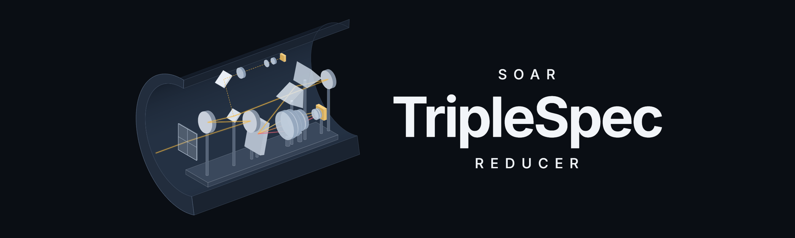
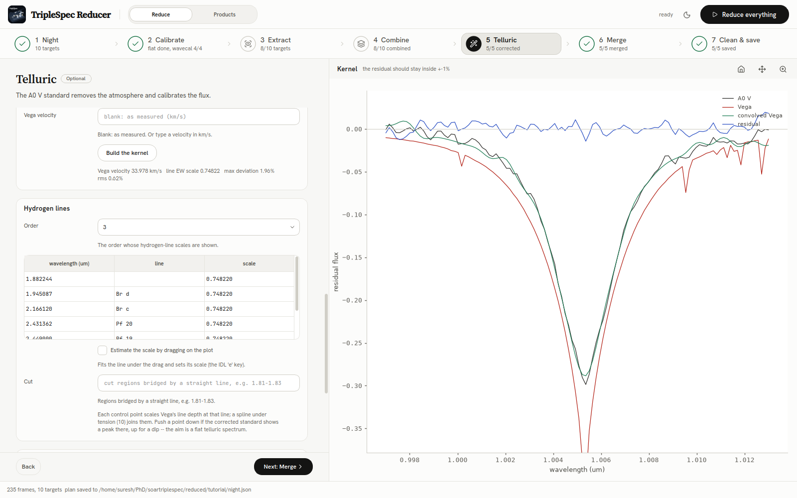

<p align="center">
  
</p>

<p align="center">
  <b>Near-infrared spectra from the SOAR TripleSpec 4.1 spectrograph, reduced from the raw frames to a
  flux-calibrated, telluric-corrected spectrum, in a desktop application that explains every step.</b>
</p>

<p align="center">
  <a href="https://sureshparekh.github.io/triplespecreducer/">Documentation</a> ·
  <a href="https://sureshparekh.github.io/triplespecreducer/tutorial/index.html">Tutorial</a> ·
  <a href="https://sureshparekh.github.io/triplespecreducer/tutorial/video.html">Videos</a> ·
  <a href="https://sureshparekh.github.io/triplespecreducer/science/index.html">The science</a>
</p>

---

TripleSpec Reducer follows the steps and the science of **Spextool** (Cushing, Vacca & Rayner 2004), the
IDL package the TripleSpec team uses, with its telluric correction (Vacca, Cushing & Rayner 2003) and the
TripleSpec module **TS4_SOAR**. Its results are checked against the IDL tool's on the same frames, and the
tests show **every product identical, bit for bit**. Around the numbers, it adds:

* **A desktop application that explains itself.** Seven steps — Night, Calibrate, Extract, Combine, Telluric,
  Merge, Clean & save — each opening with why it is needed, what it does and what to check; every control with
  a caption and a full tooltip.
* **The night is read for you.** Flats, arcs, science targets and A0 V standards are recognised from the
  headers; ABBA and object–sky nods are paired; a wavelength solution and a telluric standard are proposed for
  every target, with B and V from SIMBAD. Nothing is typed as a frame number, and everything can be changed.
* **One button reduces the night**, in parallel, or each step can be run and inspected on its own.
* **Every file is `<source>_<step>.fits`**, in Spextool's own format: give a source name and every product,
  and the log of every step, is found.

<p align="center">
  
</p>

## Install

Python 3.10 or newer. In a fresh environment:

```bash
python -m venv tsr-env
source tsr-env/bin/activate            # on Windows: tsr-env\Scripts\activate
pip install git+https://github.com/sureshparekh/triplespecreducer
```

or with conda:

```bash
conda create -n tsr python=3.12
conda activate tsr
pip install git+https://github.com/sureshparekh/triplespecreducer
```

This installs the package, the desktop interface and two commands, `tsr` and `triplespec-reducer`.
Everything the reduction reads ships with it: the TS4_SOAR instrument files, the OH and Ar line lists, the
ATRAN atmospheric models and Spextool's Vega models. IDL is not needed.

To work on the code instead:

```bash
git clone https://github.com/sureshparekh/triplespecreducer
cd triplespecreducer
pip install -e ".[test,docs]"
```

## Use

**The interface** — the way most people will use it:

```bash
tsr
```

The logo shows while it loads; then choose the folder of raw `SPEC_*.fits` frames, press **Read the night**,
check the plan, and either press **Reduce everything** or go through the steps one by one. The
[tutorial](https://sureshparekh.github.io/triplespecreducer/tutorial/index.html) reduces one galaxy, NGC 134,
from the raw frames to its final spectrum, every screen shown and explained.

**The command line**, for a whole night without a display:

```bash
tsr organize /path/to/raw/2025-11-02 reduced/2025-11-02     # read the night, write the plan (night.json)
tsr reduce   reduced/2025-11-02                              # every science target and its standard
tsr reduce   reduced/2025-11-02 NGC134                       # just one
tsr products reduced/2025-11-02 NGC134                       # every file made for it
```

**Python**:

```python
from triplespec_reducer.night import organize
from triplespec_reducer.pipeline import Reducer, Options

night = organize("/path/to/raw/2025-11-02", "reduced/2025-11-02")
Reducer(night, Options(), progress=print).run(sources=["NGC134"])
```

The raw folder is only ever read. The result for each target is `proc/<source>_merged.fits`: telluric
corrected, flux calibrated, all five orders joined.

## Documentation

**<https://sureshparekh.github.io/triplespecreducer/>** — getting started, the step-by-step tutorial with
screenshots, two narrated videos (the science and the steps; a hands-on reduction from scratch), the science and technique of every step, every setting, the
comparison with IDL, and the Python API.

The site is built from `docs/` with Sphinx (`pip install -e ".[docs]"`, then
`sphinx-build docs docs/_build/html`) and published by the workflow in `.github/workflows/docs.yml`. Its
screenshots and figures are made from a real night by `docs/make_shots.py` and `docs/make_figures.py`; the
videos by the pipeline in `video/` (see `video/README.md`).

## Agreement with IDL

`validation/` holds the IDL scripts that produce the reference outputs (they need IDL 7.1 with Spextool 4.1 and
TS4_SOAR) and the scripts that compare them; `tests/test_parity.py` asserts the identities. Every product —
flat, wavelength solution, extracted, combined, telluric-corrected, merged and cleaned spectra, and every header
— is identical to IDL's, with one exception: the telluric kernel, which IDL computes with its own
single-precision FFT, agrees to a few parts in a million. Details in the
[validation pages](https://sureshparekh.github.io/triplespecreducer/validation/index.html).

## Citing

The algorithms are Spextool's. Please cite Cushing, Vacca & Rayner (2004, PASP 116, 362), Vacca, Cushing &
Rayner (2003, PASP 115, 389) and Kirkpatrick et al. (2011, ApJS 197, 19), and this program (Parekh 2026). The
workflow follows L. G. Dahmer-Hahn's TripleSpec reduction tutorial.

Developed by Suresh Parekh at the Universidade Federal do Rio Grande do Sul, in the
[SAFFARY group](https://www.if.ufrgs.br/~riffel/saffary/index.html). MIT licence.
