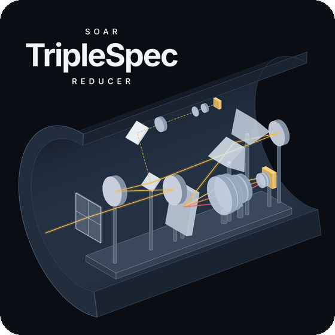

# The desktop interface

```bash
tsr                      # or: triplespec-reducer, or tsr gui /path/to/raw/night
```

```{raw} html
<figure class="themed" style="max-width:300px">
  
  <figcaption>While the reduction modules load, the logo is shown in the theme you last used.</figcaption>
</figure>
```

It is a native Qt application — not a browser page — and runs the same on Linux, macOS and
Windows. It has a light and a dark theme (the sun/moon button), and remembers the one you
last used.

```{shots} 01-night
:alt: The interface

The interface
```

---

## The parts of the window

| part | what it holds |
|---|---|
| **Header** | the logo; the **Reduce** and **Products** pages; what is running now; the theme; **Reduce everything** |
| **Step bar** | the seven steps; each shows a tick when done for every target, and a line of progress (`8/10 combined`). Click a step to go to it |
| **Left panel** | the current step: **About this step**, then its settings and buttons. **Back** and **Next** at the bottom |
| **Stage** (right) | what the step is working on — a frame, the flat, a wavelength image, profiles, spectra |
| **Status bar** | the night in numbers; the cursor's position and value on the stage |

## The explanations

Every step and every control explains itself.

* **About this step** opens each step: a paragraph on *why* the step is needed, then two
  folded sections — *What it does, in order* (the algorithm, step by step) and *What to check
  before moving on* — and the IDL routines it reproduces.
* **A caption** under every setting says in one line what it is.
* **A tooltip** on every setting (hover over it, or over its label) gives the full
  explanation and the IDL tool's default.

The same text is the [settings reference](settings.md) of this manual: both are written from
one source in the program, so they always agree.

```{shots} 01-night-about
:alt: About this step, opened

About this step, opened
```

## The stage

* **Images** (frames, the flat, wavelength images) and **spectra** (profiles, extracted and
  combined spectra, the kernel, the telluric spectrum) are drawn here.
* Its tools, top right: *home* (reset the view), *pan*, *zoom to a rectangle*. The mouse wheel
  zooms the horizontal axis; Shift + wheel the vertical one.
* **Dragging across a spectrum** fills in a wavelength range wherever the step wants one:

| step | a drag fills |
|---|---|
| Telluric | the focused field — continuum windows, line region, cut regions; with *estimate* ticked, estimates the H I scale there; with a Shift row selected, that order's region |
| Merge | the region for the selected order's automatic scale |
| Clean & save | the region to fix or remove |

## The steps

| step | you do | you see | tutorial |
|---|---|---|---|
| 1 Night | choose the raw and output folders; **Read the night**; check and edit the plan | the plan table and notes; a target's first A − B image | [1](../tutorial/1-night.md) |
| 2 Calibrate | **Build the flat**; **Calibrate all** | the normalised flat with its order edges; each wavelength solution | [2](../tutorial/2-calibrate.md) |
| 3 Extract | choose the mode and settings; **Preview the first pair**; **Extract every pair** | spatial profiles with apertures and background; each extracted spectrum | [3](../tutorial/3-extract.md) |
| 4 Combine | choose the scale order and statistic; untick spectra to leave out; **Combine** | every scaled spectrum and the combination | [4](../tutorial/4-combine.md) |
| 5 Telluric | **Load the two spectra**; **Build the kernel**; adjust the H I lines; **Find every shift**; **Write the corrected spectrum** | the kernel fit; the telluric spectrum and control points; the corrected target | [5](../tutorial/5-telluric.md) |
| 6 Merge | the anchor and each order's scale and trim; **Merge** | the orders and the merged spectrum | [6](../tutorial/6-merge.md) |
| 7 Clean & save | smoothing; fix and remove regions; **Smooth and save** | the final spectrum and its signal-to-noise | [7](../tutorial/7-clean.md) |

**Reduce everything** runs every step for every science target and its standard with the
current settings, in parallel where steps are independent. If one target fails, the others
carry on, and the failure is reported with the step and the reason.

## The Products page

Type a source name: every file made for it is listed, with its header and the log of every
step — the settings used and the results (scale factors, kernel deviations, shifts). Select a
file to plot it.

```{shots} 08-products
:alt: The Products page

The Products page
```

```{toctree}
:hidden:

settings
options
naming
automation
cli
```
