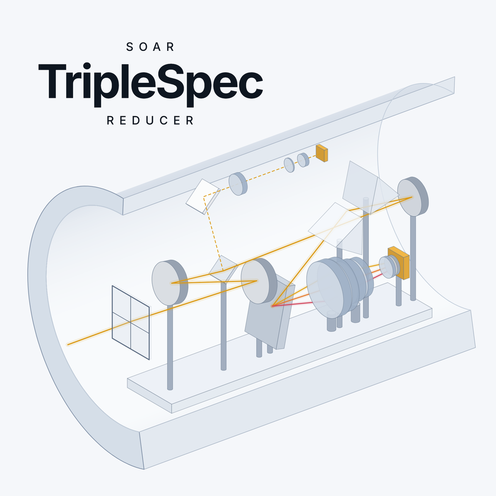
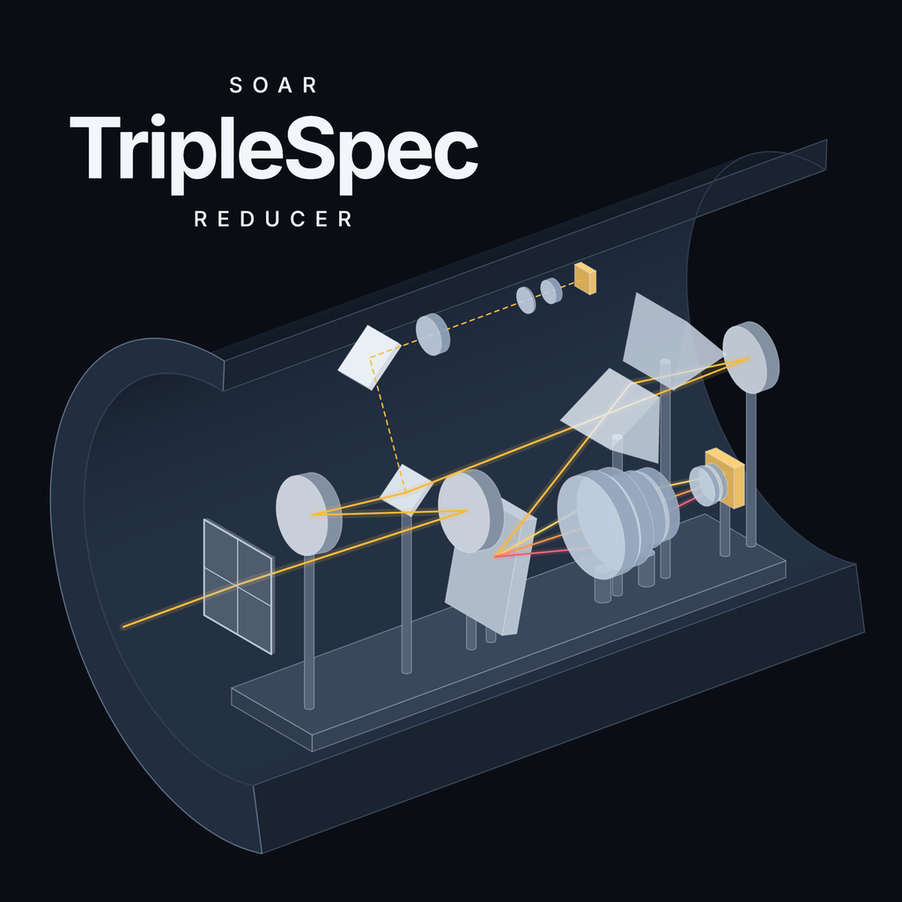

---
myst:
  html_meta:
    description: "TripleSpec Reducer: SOAR TripleSpec 4.1 near-infrared spectra reduced from the raw frames to a flux-calibrated, telluric-corrected spectrum, exactly as Spextool reduces them, in a desktop application that explains every step."
---

# TripleSpec Reducer documentation

```{raw} html
<div class="hero">
  <div>
    <p class="eyebrow">SOAR TripleSpec 4.1 · 0.94–2.47 µm · R ≈ 3500</p>
    <h1>From raw frames<br><em>to a <span class="tsr-word">calibrated spectrum</span></em></h1>
    <p class="hero-lead">A desktop application that reduces near-infrared spectra from the SOAR TripleSpec
    spectrograph: the flat, the wavelength solution, the extraction, the combination, the telluric correction
    and the merged orders, each step explained as it runs. It follows the steps and the science of
    Spextool (Cushing, Vacca &amp; Rayner 2004; Vacca, Cushing &amp; Rayner 2003), and the tests show its results to be
    identical to the IDL tool's on the same frames, bit for bit.</p>
    <button class="search-btn hero-search" type="button" data-search-open>
      <svg viewBox="0 0 24 24" aria-hidden="true"><circle cx="11" cy="11" r="6.5"/><path d="M16 16l4 4"/></svg>
      <span class="search-label">Search the documentation</span><kbd>Ctrl</kbd><kbd>K</kbd>
    </button>
    <div class="hero-actions">
      <a class="chip" href="start/install.html"><svg viewBox="0 0 24 24"><path d="M12 4v11M7.5 10.5L12 15l4.5-4.5M4.5 19.5h15"/></svg>Install</a>
      <a class="chip" href="tutorial/index.html"><svg viewBox="0 0 24 24"><rect x="3" y="4.5" width="18" height="15" rx="2.5"/><path d="M3 8.5h18"/></svg>Tutorial: one galaxy, start to finish</a>
      <a class="chip" href="tutorial/video.html"><svg viewBox="0 0 24 24"><circle cx="12" cy="12" r="8.5"/><path d="M10 8.5l5.5 3.5-5.5 3.5z"/></svg>Videos</a>
      <a class="chip" href="science/index.html"><svg viewBox="0 0 24 24"><path d="M3 17c2 0 2.5-3.5 4-3.5s1.6 4.5 3 4.5 1.8-12 3.4-12 1.7 9 3.2 9 1.7-3 4.4-3"/></svg>The science</a>
      <a class="chip" href="reference/api.html"><svg viewBox="0 0 24 24"><path d="M8.5 8l-4.5 4 4.5 4M15.5 8l4.5 4-4.5 4"/></svg>Python API</a>
    </div>
  </div>
  <div class="hero-logo">
    
    
  </div>
</div>

<section class="home-section">
  <h2>Choose how you work</h2>
  <p>The interface is the program: it reads the night, proposes the plan, and walks through the reduction step by
  step, every control explained. The command line and the Python library run the same code with the same settings,
  so a night gives the same files whichever you use.</p>
  <div class="codepanel" data-codepanel>
    <div class="codepanel-tabs" role="tablist">
      <button type="button" data-tab="gui" aria-selected="true">Interface</button>
      <button type="button" data-tab="cli" aria-selected="false">Command line</button>
      <button type="button" data-tab="py" aria-selected="false">Python</button>
    </div>
<pre data-pane="gui">tsr

<span class="c-c">1 Night</span>        the raw folder → Read the night → check the plan
<span class="c-c">2 Calibrate</span>    Build the flat → Calibrate all
<span class="c-c">3 Extract</span>      Preview the first pair → Extract every pair
<span class="c-c">4 Combine</span>      Combine
<span class="c-c">5 Telluric</span>     Load → Build the kernel → Find every shift → Write
<span class="c-c">6 Merge</span>        Merge
<span class="c-c">7 Clean &amp; save</span> Smooth and save          <span class="c-c">or: Reduce everything</span></pre>
<pre data-pane="cli" hidden>tsr organize data/raw/2025-11-02 reduced/2025-11-02
tsr reduce   reduced/2025-11-02                 <span class="c-c"># every science target</span>
tsr reduce   reduced/2025-11-02 NGC134          <span class="c-c"># just one</span>
tsr products reduced/2025-11-02 NGC134          <span class="c-c"># every file made for it</span></pre>
<pre data-pane="py" hidden><span class="c-k">from</span> triplespec_reducer.night <span class="c-k">import</span> organize
<span class="c-k">from</span> triplespec_reducer.pipeline <span class="c-k">import</span> Reducer, Options

night = <span class="c-f">organize</span>(<span class="c-s">"data/raw/2025-11-02"</span>, <span class="c-s">"reduced/2025-11-02"</span>)
r = <span class="c-f">Reducer</span>(night, <span class="c-f">Options</span>(apradius=<span class="c-n">1.2</span>), progress=<span class="c-f">print</span>)
r.<span class="c-f">run</span>(sources=[<span class="c-s">"NGC134"</span>])</pre>
  </div>
</section>

<section class="home-section">
  <h2>Start in four steps</h2>
  <p>About fifteen minutes from nothing to a reduced galaxy, on a real night.</p>
  <div class="path">
    <a href="start/install.html"><span class="p-step">Step 1</span><span class="p-title">Install</span><span class="p-text">One pip command, the interface included.</span></a>
    <a href="start/data.html"><span class="p-step">Step 2</span><span class="p-title">Know the data</span><span class="p-text">Flats, arcs, nodded targets and A0 V standards: what each frame is for.</span></a>
    <a href="tutorial/index.html"><span class="p-step">Step 3</span><span class="p-title">Reduce a galaxy</span><span class="p-text">NGC 134, from the raw frames to its final spectrum, every screen shown.</span></a>
    <a href="tutorial/video.html"><span class="p-step">Step 4</span><span class="p-title">Watch it</span><span class="p-text">Two narrated films: the science of every step, and the reduction from scratch in the interface.</span></a>
  </div>
</section>

<section class="home-section">
  <h2>Understand the reduction</h2>
  <p>What every step does to the data, why, and the exact algorithm, with the Spextool routine it reproduces.</p>
  <div class="cards">
    <a class="card" href="science/instrument.html"><span class="card-icon"><svg viewBox="0 0 24 24"><path d="M3 17c2 0 2.5-3.5 4-3.5s1.6 4.5 3 4.5 1.8-12 3.4-12 1.7 9 3.2 9 1.7-3 4.4-3"/><path d="M3 20.5h18"/></svg></span><span class="card-title">The instrument</span><span class="card-text">Five orders in one exposure, the atmosphere, and why the sky is removed by nodding.</span></a>
    <a class="card" href="science/flat.html"><span class="card-icon"><svg viewBox="0 0 24 24"><rect x="4" y="4" width="6.5" height="6.5" rx="1.5"/><rect x="13.5" y="4" width="6.5" height="6.5" rx="1.5"/><rect x="4" y="13.5" width="6.5" height="6.5" rx="1.5"/><rect x="13.5" y="13.5" width="6.5" height="6.5" rx="1.5"/></svg></span><span class="card-title">The flat field</span><span class="card-text">The detector's pixel sensitivity, and where the orders lie.</span></a>
    <a class="card" href="science/wavecal.html"><span class="card-icon"><svg viewBox="0 0 24 24"><path d="M3 19h18"/><path d="M5 19c1.5 0 2-1 2.5-1s.7-12 1.5-12 .8 12 1.5 12h3c.7 0 .8-7 1.5-7s.8 7 1.5 7H19"/></svg></span><span class="card-title">Wavelengths</span><span class="card-text">The night sky's OH lines give every pixel a wavelength and a slit position.</span></a>
    <a class="card" href="science/extraction.html"><span class="card-icon"><svg viewBox="0 0 24 24"><path d="M4 4v16h16"/><path d="M7.5 15l3.5-4.5 3 2.5 5-6.5"/></svg></span><span class="card-title">Extraction</span><span class="card-text">A − B, the spatial profile, apertures, traces and the summed spectrum.</span></a>
    <a class="card" href="science/telluric.html"><span class="card-icon"><svg viewBox="0 0 24 24"><circle cx="12" cy="12" r="1.6"/><ellipse cx="12" cy="12" rx="9" ry="3.6"/><ellipse cx="12" cy="12" rx="9" ry="3.6" transform="rotate(60 12 12)"/><ellipse cx="12" cy="12" rx="9" ry="3.6" transform="rotate(120 12 12)"/></svg></span><span class="card-title">Telluric correction</span><span class="card-text">An A0 V star and Vega's model remove the atmosphere and give the flux its units.</span></a>
    <a class="card" href="validation/index.html"><span class="card-icon"><svg viewBox="0 0 24 24"><circle cx="12" cy="12" r="8.5"/><path d="M8 12.3l2.6 2.6L16 9.5"/></svg></span><span class="card-title">Agreement with IDL</span><span class="card-text">Every product compared with IDL's on the same frames: identical, to the last bit.</span></a>
  </div>
</section>

<section class="home-section">
  <h2>Exactly Spextool, faster</h2>
  <p>Checked against IDL 7.1 with Spextool 4.1 and TS4_SOAR on the night of 2025 November 2, on one workstation.</p>
  <div class="speed">
    <div><span class="speed-task">Products compared with IDL's</span>
      <p class="speed-row"><b>bit-identical</b><span>every pixel, every header card</span></p></div>
    <div><span class="speed-task">One A − B pair, extracted</span>
      <p class="speed-row"><b>12 s</b><span>one process</span></p></div>
    <div><span class="speed-task">The whole night: 4 wavelength solutions, 56 pairs</span>
      <p class="speed-row"><b>4.5 min</b><span>16 processes</span></p></div>
  </div>
  <p class="speed-note"><b>The exception:</b> the telluric kernel is made with IDL's own single-precision FFT,
  which no available FFT reproduces bit for bit; it agrees to a few parts in a million, and every step fed IDL's
  kernel is identical. <a href="validation/index.html">The comparison, step by step</a>.</p>
</section>

<section class="home-section">
  <h2>Look it up</h2>
  <p>Every setting, file and command.</p>
  <div class="cards">
    <a class="card" href="gui/settings.html"><span class="card-icon"><svg viewBox="0 0 24 24"><circle cx="12" cy="12" r="3"/><path d="M12 2.8v2.4M12 18.8v2.4M2.8 12h2.4M18.8 12h2.4M5.5 5.5l1.7 1.7M16.8 16.8l1.7 1.7M5.5 18.5l1.7-1.7M16.8 7.2l1.7-1.7"/></svg></span><span class="card-title">Every setting</span><span class="card-text">Each control of the interface, what it does and the IDL tool's default.</span></a>
    <a class="card" href="gui/naming.html"><span class="card-icon"><svg viewBox="0 0 24 24"><path d="M6.5 3.5h7.5l4.5 4.5v12.5h-12z"/><path d="M14 3.5V8h4.5M9 13h6M9 16.5h6"/></svg></span><span class="card-title">Files and names</span><span class="card-text">Every product is <code>&lt;source&gt;_&lt;step&gt;.fits</code>, in Spextool's own format.</span></a>
    <a class="card" href="reference/troubleshooting.html"><span class="card-icon"><svg viewBox="0 0 24 24"><circle cx="12" cy="12" r="8.5"/><path d="M9.6 9.5a2.5 2.5 0 1 1 3.4 2.3c-.6.3-1 .8-1 1.5v.7M12 16.8v.2"/></svg></span><span class="card-title">Troubleshooting</span><span class="card-text">What to do when a step does not go as expected.</span></a>
  </div>
</section>

<p class="home-foot">TripleSpec Reducer is developed at the Universidade Federal do Rio Grande do Sul, in the <a href="https://www.if.ufrgs.br/~riffel/saffary/index.html">SAFFARY group</a>. It follows the steps and the science of Spextool (Cushing, Vacca &amp; Rayner 2004; Vacca, Cushing &amp; Rayner 2003) and K. Allers' TS4_SOAR module. <a href="reference/citing.html">How to cite</a> · <a href="reference/sources.html">Sources</a>.</p>
```

```{toctree}
:hidden:

start/index
tutorial/index
gui/index
science/index
validation/index
reference/index
```
